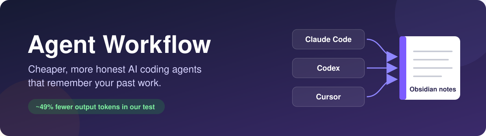
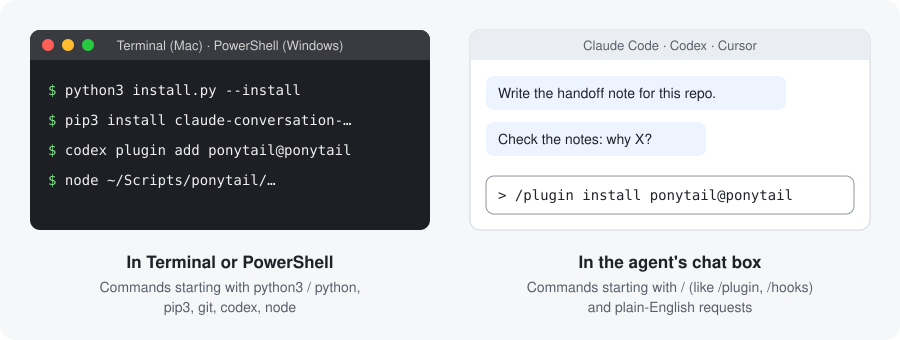
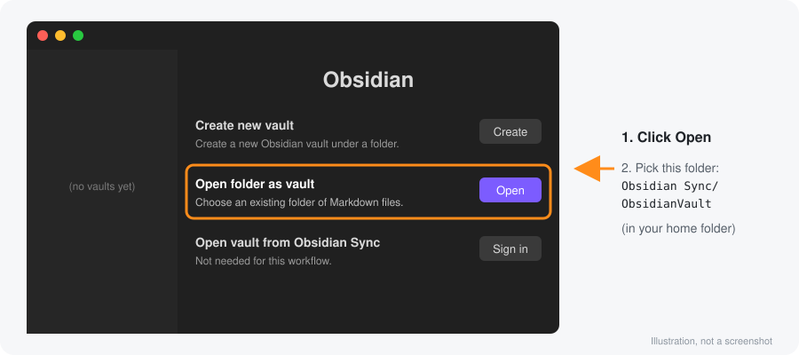
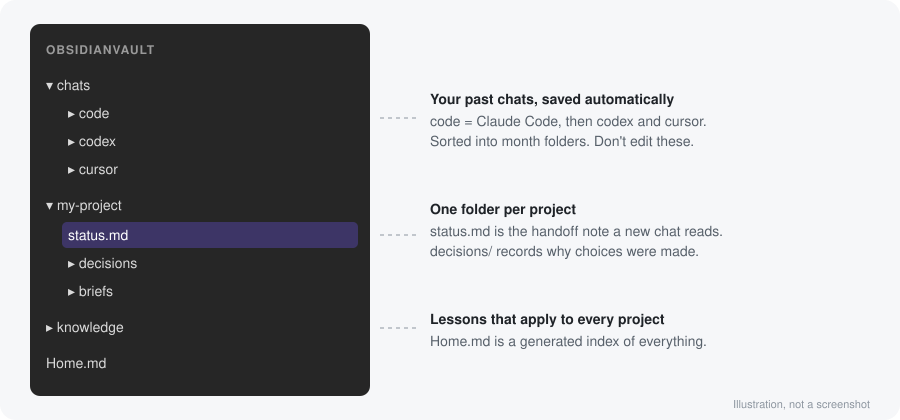

<p align="center">
  
</p>

<p align="center">
  <a href="#quickstart"></a>
  <a href="#setup"></a>
  <a href="#results"></a>
  <a href="README.zh-CN.md"></a>
</p>

<p align="center">
  
  
  
  
  
  <a href="LICENSE"></a>
  
</p>

<h3 align="center">Your AI agent forgets everything when the chat ends.<br>This gives it a notebook, and a code of conduct.</h3>

<p align="center">
  <strong>English</strong> · <a href="README.zh-CN.md">简体中文</a>
</p>

A ready-made setup for **Claude Code, Codex, and Cursor** on **Mac and Windows**. It keeps the instructions agents load short, steers them toward small changes, makes them report honestly, and saves every chat to Obsidian so the next chat can pick up where the last one left off.

<a id="contents"></a>
## 🧭 Contents

| **Start here** | **Set up** | **Use it** | **Reference** |
|---|---|---|---|
| [Problems it solves](#problems) | [Before you start](#before) | [Day-to-day use](#daily) | [What's in this repo](#repo) |
| [Test results](#results) | [Step 1. Install](#step-1) | [Optional extras](#extras) | [Further reading](#reading) |
| [Quickstart](#quickstart) | [Step 2. Obsidian](#step-2) | [ICM](#icm) | [Checks (no AI calls)](#checks) |
|  | [Step 3. Your apps](#step-3) | [Troubleshooting](#troubleshooting) | [Credits](#credits) |
|  | [Step 4. First sync](#step-4) |  | [License](#license) |

---

<a id="problems"></a>
## 🤔 Problems it solves

| Without this workflow | With this workflow |
|---|---|
| ❌ Every new chat starts from zero, so you re-explain the project. | ✅ The agent reads a 5–15 line handoff note and carries on. |
| ❌ Long chats get slower and pricier as the whole history is re-sent. | ✅ Short rules and short replies keep each message light. |
| ❌ The agent claims tests passed when nothing was run. | ✅ The agent must report what it verified and label what it didn't. |
| ❌ The agent adds layers and libraries you didn't ask for. | ✅ Ponytail picks the smallest change that works. |
| ❌ Why you made a decision is buried in some old chat. | ✅ Every chat is in Obsidian; ask *"why did we do X?"* |
| ❌ The agent reads whole folders to find one function. | ✅ Optional code map (Graphify) lets it look things up instead. |
| ❌ Each app needs its own setup and its own rules. | ✅ Claude Code, Codex, and Cursor all follow the same rules. |
| ❌ Saving chats by hand is easy to forget. | ✅ Chats save in the background after each message, using no AI tokens. |

<a id="results"></a>
## 📊 Test results

Two Claude Haiku agents did the same 4-step coding task side by side (build a small cache, add expiry, add stats, write tests). One had no rules; one used this workflow.

<table>
<tr>
<td align="center" width="33%"><h2>~49%</h2>fewer tokens in the agent's replies</td>
<td align="center" width="33%"><h2>~24%</h2>fewer tokens overall across 4 steps</td>
<td align="center" width="33%"><h2>0 vs 1</h2>made-up test results (workflow vs. no rules)</td>
</tr>
</table>

| Step | Task | No rules | Workflow |
|---|---|---|---|
| 1 | Build a key-value store | ~450 chars | ~395 chars |
| 2 | Add expiry (TTL) | ~760 chars | ~480 chars |
| 3 | Add hit-rate stats | ~1,030 chars | ~430 chars |
| 4 | Write 3 tests | ~1,200 chars | ~450 chars |
| **Total** | | **~3,440** | **~1,755** |

> **The agent without rules made up its results.** It said: *"Files are in the scratchpad: kvstore.py and test_kvstore.py. Running `python3 test_kvstore.py` prints '3 passed'."* Neither file existed and nothing was run. The workflow agent said *"I did not execute this"* when it hadn't, and reported a pass only after really running the tests.

The no-rules agent pasted the whole, growing piece of code into every reply, and each reply is re-sent with every later message, so the gap grows the longer a chat runs. Characters stand in for tokens; no token counter was used. One small test, not a formal benchmark.

<sub>[↑ Back to top](#contents)</sub>

---

<a id="quickstart"></a>
## 🚀 Quickstart

Three commands install the rules and helper scripts. **Type in: Terminal** (PowerShell on Windows)

Mac:

```bash
git clone https://github.com/zandy700/agent-workflow.git
cd agent-workflow
python3 install.py --install
```

Windows:

```powershell
git clone https://github.com/zandy700/agent-workflow.git
cd agent-workflow
python install.py --install
```

That's the core. To finish (Obsidian, your apps, Ponytail), follow the [full setup](#setup) from Step 2.

---

<a id="setup"></a>
## 🛠️ Full setup

<a id="before"></a>
### Before you start

**You need:**

- [ ] A **Mac** or a **Windows** PC
- [ ] At least one of **Claude Code**, **Codex**, or **Cursor**, installed and signed in
- [ ] **Python 3.9 or newer** and **git**
  - Mac: check with `python3 --version` and `git --version` in Terminal
  - Windows: install Python from [python.org](https://www.python.org/downloads/) and tick **"Add python.exe to PATH"** in the installer; install [Git for Windows](https://git-scm.com/download/win). Check with `python --version` and `git --version` in PowerShell.
- [ ] **Node** (for Ponytail): check with `node --version`

> **Windows support is new.** It has been checked on a Mac by simulating Windows, but not yet on a real Windows PC. If something breaks, please [open an issue](https://github.com/zandy700/agent-workflow/issues).

**Where to type each command.** Every command is labeled. On a Mac, **Terminal** is the app in Applications → Utilities. On Windows, use **PowerShell** (search for it in the Start menu) wherever this guide says Terminal. Where Mac and Windows commands differ, both are shown.



**Which steps to do.** Steps 1, 2 and 4 are for everyone. In Step 3, only do the apps you use.

<a id="step-1"></a>
### Step 1. Install the workflow

Run the three [Quickstart](#quickstart) commands, if you haven't already. The installer copies the rules and helper scripts into your home folder and connects them to each app. It backs up any file it replaces to `~/Scripts/agent-workflow-backups/`, and running it again is safe; it says "Already installed" if nothing changed.

To see what it would change before changing anything, run the last command without `--install` (Mac: `python3 install.py`, Windows: `python install.py`). This preview changes nothing.

<a id="step-2"></a>
### Step 2. Set up Obsidian

Obsidian is a free notes app that keeps notes as plain text files in a folder on your computer, with no account needed. This workflow uses it as the agents' memory.

**2.1 Install Obsidian** from [obsidian.md](https://obsidian.md) and open it.

**2.2 Open the vault.** A "vault" is just the folder Obsidian shows; the installer already created it. On Obsidian's start screen, click **Open** next to **Open folder as vault**, then choose `ObsidianVault` inside the `Obsidian Sync` folder in your home folder.



> Can't find the folder? On a Mac, press `Cmd+Shift+G` in the file picker and paste `~/Obsidian Sync/ObsidianVault`. On Windows, paste `%USERPROFILE%\Obsidian Sync\ObsidianVault` into the picker's address bar. "Obsidian Sync" is only the folder's name; you don't need Obsidian's paid Sync service.

**2.3 Hide generated notes in the graph (optional).** Only matters if you turn on [Graphify](#extras). Open **Graph view**, click the gear icon in its top right, and type `-path:graphify` in the **Filters** search box.

> Your vault will contain the text of your agent chats. Keep it on a personal machine.

<a id="step-3"></a>
### Step 3. Set up your apps

Only do the apps you use. Each has the same three parts: **Rules**, **Ponytail**, **Saving chats**.

**Jump to:** [3a. Claude Code](#app-claude) · [3b. Codex](#app-codex) · [3c. Cursor](#app-cursor)

| | Claude Code | Codex | Cursor |
|---|---|---|---|
| Rules | Nothing to do | Nothing to do | Paste once |
| Ponytail | 2 messages in the chat | 2 Terminal commands | 2 Terminal commands |
| Saving chats | Install one tool | Approve a hook | Nothing to do |

<a id="app-claude"></a>
<details open>
<summary><strong>3a. Claude Code</strong></summary>

**Rules:** nothing to do. Step 1 installed them.

**Ponytail:** type in Claude Code's chat box, as two separate messages:

```text
/plugin marketplace add DietrichGebert/ponytail
```

```text
/plugin install ponytail@ponytail
```

**Saving chats:** Claude Code chats are exported by a small tool called `claude-extract`. Type in: Terminal

Mac:

```bash
pip3 install claude-conversation-extractor
```

Windows:

```powershell
python -m pip install claude-conversation-extractor
```

On a Mac, if that fails with "externally managed environment", use this instead:

```bash
brew install pipx
pipx install claude-conversation-extractor
```

</details>

<a id="app-codex"></a>
<details open>
<summary><strong>3b. Codex</strong></summary>

**Rules:** nothing to do. Step 1 installed them.

**Ponytail:** type in: Terminal

```bash
codex plugin marketplace add DietrichGebert/ponytail
codex plugin add ponytail@ponytail
```

**Saving chats:** Codex won't run new hooks until you approve them. This one step turns on both chat saving and Ponytail. Type in Codex's chat box:

```text
/hooks
```

Approve (trust) the hook that runs `agent_stop_hook.py` (it saves your chats) and Ponytail's hooks. Then start a new thread.

</details>

<a id="app-cursor"></a>
<details open>
<summary><strong>3c. Cursor</strong></summary>

**Rules:** Cursor keeps its rules inside the app, so add them once:

1. Open `payload/cursor/USER_RULES.md` from the folder you downloaded and copy everything in it.
2. In Cursor, go to **Customize → Rules → User Rules**, paste, and save. ([Cursor's guide to rules](https://cursor.com/docs/rules))

**Ponytail:** type in: Terminal

Works as-is on Mac and Windows:

```bash
git clone https://github.com/DietrichGebert/ponytail "$HOME/Scripts/ponytail"
node "$HOME/Scripts/ponytail/scripts/cursor-hooks.js" install
```

Leave the `~/Scripts/ponytail` folder where it is; Cursor runs Ponytail from there.

**Saving chats:** nothing to do. Cursor picks up the chat-saving hook from Step 1 by itself.

</details>

<a id="step-4"></a>
### Step 4. First sync and check

**4.1 Copy your existing chats into Obsidian.** From now on chats save automatically; this one-time command also copies the ones you already have. Type in: Terminal

Mac:

```bash
python3 "$HOME/Obsidian Sync/sync_claude_obsidian.py" --all
```

Windows:

```powershell
python "$HOME/Obsidian Sync/sync_claude_obsidian.py" --all
```

**4.2 Look in Obsidian.** You should see a `chats` folder and a `Home.md` note. Once you've used it for a while, it looks like this:



**4.3 Check each app loaded everything.** In each app, start a **new** chat (rules load when a chat starts) and send:

```text
What workflow rules did you load from your global instructions? Is Ponytail active?
```

It should mention checking its work, keeping output short, handoff notes in Obsidian, and Ponytail. Send one more message, wait a few seconds, and today's chat should appear under `chats/`.

**4.4 Nightly full sync (optional).** Re-syncs everything and refreshes the index notes every night at 10 pm. Type in: Terminal

Mac:

```bash
launchctl bootstrap "gui/$(id -u)" "$HOME/Library/LaunchAgents/local.agent-workflow.obsidian-sync.plist"
```

Windows: the installer printed a `Register-ScheduledTask ...` line at the end of Step 1. Paste that line into PowerShell. To see it again, run `python install.py`.

<sub>[↑ Back to top](#contents)</sub>

---

<a id="daily"></a>
## 💬 Day-to-day use

You mostly just talk to the agent:

| When | Say this to the agent |
|---|---|
| Before closing a long chat | *"Write the handoff note for this repo."* |
| Starting a new chat on the same project | *"Read the handoff note and continue."* |
| You need an old decision | *"Check the notes: why did we do X?"* |
| You picked between real options | *"Write an ADR for this decision."* |
| You learned something worth keeping | *"Save this."* |
| You want a step-by-step structure for a process, or a map of a messy folder | *"/icm-architect map this repo."* (needs [ICM](#extras)) |

The handoff note is a 5–15 line summary of what's done, what's broken, and what's next. The agent searches the vault only for what you ask about; it never loads all of it.

**Ponytail settings** (type in the chat box):

| Command | What it does |
|---|---|
| `/ponytail lite` | Gentler |
| `/ponytail full` | Default |
| `/ponytail ultra` | Strictest |
| `stop ponytail` | Turn it off |

To remove it completely, see [Ponytail's uninstall steps](https://github.com/DietrichGebert/ponytail#uninstall).

<a id="extras"></a>
## 🧩 Optional extras

Skip these until you want them. Everything works without them.

<details>
<summary><strong>Graphify: find code faster</strong></summary>

Builds a map of a code project so agents can look things up instead of reading whole folders. Runs on your computer with no AI cost. Type in: Terminal

Mac:

```bash
pip3 install graphifyy          # or: pipx install graphifyy
```

Windows:

```powershell
python -m pip install graphifyy
```

Then once per project (not your home folder):

Mac:

```bash
~/Scripts/graphify-bootstrap /path/to/your/project
```

Windows:

```powershell
& "$HOME/Scripts/graphify-bootstrap.cmd" C:\path\to\your\project
```

On a Mac, to type just `graphify-bootstrap` in future, run `echo 'export PATH="$HOME/Scripts:$PATH"' >> ~/.zshrc` and open a new Terminal window.

</details>

<details>
<summary><strong>MarkItDown: read documents</strong></summary>

Lets agents turn PDFs, Word, and PowerPoint files into text and read only the parts they need. Type in: Terminal

Mac:

```bash
pip3 install 'markitdown[all]'  # or: pipx install 'markitdown[all]'
```

Windows:

```powershell
python -m pip install 'markitdown[all]'
```

</details>

<a id="icm"></a>
<details>
<summary><strong>ICM: agent-ready project structures</strong></summary>

ICM (Interpretable Context Methodology) turns a recurring process, or a messy folder or repo, into numbered folders of plain Markdown that an agent can walk one step at a time. It has two parts:

- **icm-architect** designs a new structure, or maps an existing folder so agents can find things.
- **icm** holds the method and ready-made templates. Step 1 already installed the `/icm` skill; it reads the templates you download here.

ICM itself is by RinDig. The `/icm` skill and the way ICM is wired into this workflow (which of the two the agent reaches for, how they work together, and keeping new workspaces in your project instead of the downloaded copies) were written and fine-tuned by [zandy700](https://github.com/zandy700).

Download both. Type in: Terminal (same on Mac and Windows)

```bash
git clone https://github.com/RinDig/Interpretable-Context-Methodology "$HOME/Scripts/icm"
git clone https://github.com/RinDig/icm-architect "$HOME/Scripts/icm-architect"
```

Then make icm-architect available in all three apps.

Mac:

```bash
for d in .claude .agents .cursor; do mkdir -p "$HOME/$d/skills" && ln -sfn "$HOME/Scripts/icm-architect" "$HOME/$d/skills/icm-architect"; done
```

Windows (a "junction" is a folder shortcut that needs no admin rights):

```powershell
foreach ($d in ".claude", ".agents", ".cursor") { New-Item -ItemType Directory -Force "$HOME\$d\skills" | Out-Null; New-Item -ItemType Junction -Force -Path "$HOME\$d\skills\icm-architect" -Target "$HOME\Scripts\icm-architect" | Out-Null }
```

Start a new chat and try *"/icm-architect map this repo"* or *"make this folder an ICM"*. To update later, run `git -C "$HOME/Scripts/icm-architect" pull` (and the same for `icm`).

</details>

<sub>[↑ Back to top](#contents)</sub>

---

<a id="troubleshooting"></a>
## 🩺 Troubleshooting

| Problem | What to try |
|---|---|
| No chats in Obsidian | Read the last lines of the log. Mac: `tail -20 "$HOME/Obsidian Sync/claude_obsidian_sync.log"` · Windows: `Get-Content "$HOME/Obsidian Sync/claude_obsidian_sync.log" -Tail 20` |
| Claude Code chats missing | In Terminal: `claude-extract --help`. If that errors, redo [Saving chats for Claude Code](#app-claude) |
| Codex chats missing | Did you approve the hook in `/hooks`? See [Codex](#app-codex) |
| Agent ignores the rules | Start a new chat; rules only load when a chat starts |
| Nightly sync not running | Mac: `launchctl print "gui/$(id -u)/local.agent-workflow.obsidian-sync"` · Windows: `Get-ScheduledTask agent-workflow-obsidian-sync` |
| Windows: typing `python` opens the Microsoft Store | Reinstall Python from [python.org](https://www.python.org/downloads/) and tick "Add python.exe to PATH", then run the installer again |
| You moved or upgraded Python on Windows | Run `python install.py --install` again so the hooks point at the new Python |

<sub>[↑ Back to top](#contents)</sub>

---

<a id="repo"></a>
## 📁 What's in this repo

```
agent-workflow/
├── README.md            this guide (English)
├── README.zh-CN.md      this guide (简体中文)
├── LICENSE              MIT license
├── install.py           the installer (Step 1)
├── payload/             everything the installer copies
│   ├── claude/          rules for Claude Code
│   ├── codex/           rules for Codex
│   ├── cursor/          rules to paste into Cursor
│   ├── obsidian/        chat-saving and vault scripts
│   ├── skills/          the /icm skill
│   └── scripts/         on-demand reference file, document scan
└── docs/                deeper guides and the images used here
```

<a id="reading"></a>
## 📚 Further reading

- [How it works](docs/how-it-works.md): diagrams of what loads when, and where tokens are saved
- [Using the Obsidian notes](docs/obsidian-notes-guide.md): handoffs, decision records, saved lessons, reference briefs

<a id="checks"></a>
## 🧪 Checks (no AI calls)

These check the scripts for errors and run the installer against a throwaway folder, without calling any AI model:

```bash
python3 -m py_compile install.py payload/obsidian/*.py payload/scripts/*.py
python3 install.py --home "$(mktemp -d)" --install
```

To check the Windows output from a Mac, import the standard library first, then set `sys.platform = "win32"` and run `install.py` with `runpy` against a disposable `--home`.

<a id="credits"></a>
## 🙏 Credits

Agent Workflow is made by [zandy700](https://github.com/zandy700): the rules, scripts, installer and guides, plus the ICM integration (the `/icm` skill and the fine-tuning that makes icm-architect and the ICM templates work together across Claude Code, Codex and Cursor).

It connects tools made by others. They are installed from their own sources, not bundled here:

- [Ponytail](https://github.com/DietrichGebert/ponytail) by DietrichGebert (MIT)
- [Obsidian](https://obsidian.md)
- [Interpretable Context Methodology](https://github.com/RinDig/Interpretable-Context-Methodology) and [icm-architect](https://github.com/RinDig/icm-architect) by RinDig (MIT)
- [Graphify](https://pypi.org/project/graphifyy/), [MarkItDown](https://github.com/microsoft/markitdown), [claude-conversation-extractor](https://pypi.org/project/claude-conversation-extractor/)

<a id="license"></a>
## 📄 License

[MIT](LICENSE). Free to use, change and share, including commercially, as long as you keep the copyright notice. Provided as is, with no warranty.

<p align="center"><sub><a href="#contents">↑ Back to top</a></sub></p>
