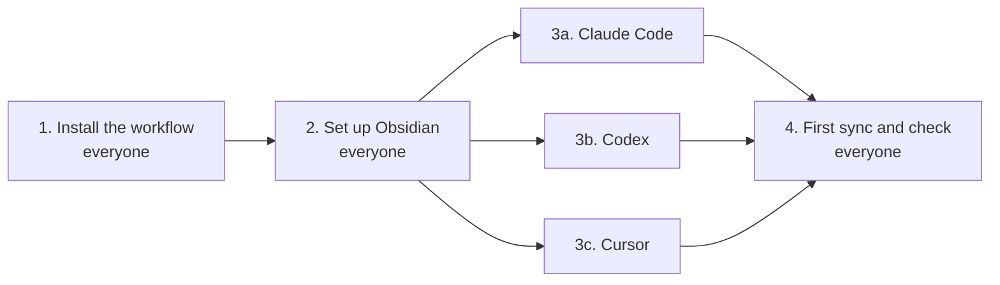

# Agent workflow (macOS)

**English** | [简体中文](README.zh-CN.md)

A setup for **Claude Code, Codex, and Cursor** that makes AI coding agents cheaper to run, more honest about what they did, and able to remember past work.

- **Lighter on every message.** The rules that load into every chat are kept short. Detailed instructions sit in a separate file the agent opens only when it needs them.
- **Smaller, simpler changes.** [Ponytail](https://github.com/DietrichGebert/ponytail) steers agents toward the smallest change that works instead of over-building.
- **Honest reporting.** Agents must say what they actually checked and flag anything they didn't test.
- **Memory between chats.** Every chat is saved to Obsidian, a free notes app. A new chat can pick up from a short note instead of you re-explaining everything.
- **Works quietly in the background.** Saving chats happens automatically after each message and costs no AI usage.
- **One setup, three apps.** Claude Code, Codex, and Cursor follow the same rules.

<a id="contents"></a>
## Contents

1. **About**
   - [Test results](#results)
2. **Set up**
   - [Before you start](#before)
   - [Step 1. Install the workflow](#step-1)
   - [Step 2. Set up Obsidian](#step-2)
   - [Step 3. Set up your apps](#step-3): [Claude Code](#app-claude) · [Codex](#app-codex) · [Cursor](#app-cursor)
   - [Step 4. First sync and check](#step-4)
3. **Use**
   - [Day-to-day use](#daily)
   - [Optional extras](#extras)
4. **Help**
   - [Troubleshooting](#troubleshooting)
   - [What's in this repo](#repo)
   - [Further reading](#reading)
   - [For contributors](#contributors)

---

<a id="results"></a>
## Test results

Two Claude Haiku agents did the same 4-step coding task side by side (build a small cache, add expiry, add stats, write tests). One had no rules; one used this workflow.

- **~49% fewer tokens in the agent's replies**, and **~24% fewer overall** across the 4 steps. The gap grew every step, so longer chats save more.
- **The agent without rules made up its results.** It said: *"Files are in the scratchpad: kvstore.py and test_kvstore.py. Running `python3 test_kvstore.py` prints '3 passed'."* Neither file existed and nothing was run. The workflow agent said *"I did not execute this"* when it hadn't, and reported a pass only after really running the tests.

| Step | Task | No rules | Workflow |
|---|---|---|---|
| 1 | Build a key-value store | ~450 chars | ~395 chars |
| 2 | Add expiry (TTL) | ~760 chars | ~480 chars |
| 3 | Add hit-rate stats | ~1,030 chars | ~430 chars |
| 4 | Write 3 tests | ~1,200 chars | ~450 chars |
| **Total** | | **~3,440** | **~1,755** |

The no-rules agent pasted the whole, growing piece of code into every reply. Each reply is re-sent with every later message, so that cost piles up. Characters are used as a stand-in for tokens; no token counter was used. This was one small test, not a formal benchmark.

<sub>[↑ Back to contents](#contents)</sub>

---

<a id="before"></a>
## Before you start

### What you need

- [ ] A Mac
- [ ] At least one of: **Claude Code**, **Codex**, or **Cursor**, installed and signed in
- [ ] **Python 3** and **git**. Check by typing `python3 --version` and `git --version` in Terminal.
- [ ] **Node** (for Ponytail). Check with `node --version`.

### Where to type each command

Every command is labeled with where it goes. Terminal is the Mac app in Applications → Utilities.


### The setup at a glance



Steps 1, 2 and 4 are for everyone. In Step 3, **only do the sections for the apps you use.**

<sub>[↑ Back to contents](#contents)</sub>

---

<a id="step-1"></a>
## Step 1. Install the workflow

The installer copies the rules and helper scripts into your home folder and connects them to each app. It shows what it will change before changing anything, and backs up any file it replaces.

### 1.1 Download

**Type in: Terminal**

```bash
git clone https://github.com/zandy700/agent-workflow.git
cd agent-workflow
```

### 1.2 Preview (changes nothing)

**Type in: Terminal**

```bash
python3 install.py
```

You'll see a list of the files it would write.

### 1.3 Install

**Type in: Terminal**

```bash
python3 install.py --install
```

Any file it replaces is backed up to `~/Scripts/agent-workflow-backups/`. Running it again is safe; it says "Already installed" if nothing changed.

<sub>[↑ Back to contents](#contents)</sub>

---

<a id="step-2"></a>
## Step 2. Set up Obsidian

Obsidian is a free notes app. It keeps notes as plain text files in a folder on your Mac, with no account needed. This workflow uses it as the agents' memory: your chats land there automatically, and you can ask an agent to look things up in it later.

### 2.1 Install Obsidian

Download it from [obsidian.md](https://obsidian.md) and open it.

### 2.2 Open the vault

A "vault" is just the folder Obsidian shows. The installer already created one for you.

On Obsidian's start screen, click **Open** next to **Open folder as vault**, then choose `ObsidianVault` inside the `Obsidian Sync` folder in your home folder.


> Can't find the folder? In the file picker, press `Cmd+Shift+G` and paste `~/Obsidian Sync/ObsidianVault`.
>
> "Obsidian Sync" is only the folder's name. You don't need Obsidian's paid Sync service.

### 2.3 Hide generated notes in the graph (optional)

Only matters if you turn on [Graphify](#extras) later. Open **Graph view**, click the gear icon in its top right, and type `-path:graphify` in the **Filters** search box.

> Your vault will contain the text of your agent chats. Keep it on a personal machine.

<sub>[↑ Back to contents](#contents)</sub>

---

<a id="step-3"></a>
## Step 3. Set up your apps

Only do the sections for the apps you use. Each one has the same three parts: **Rules**, **Ponytail**, **Saving chats**.

**Jump to your app:**

- [3a. Claude Code](#app-claude)
- [3b. Codex](#app-codex)
- [3c. Cursor](#app-cursor)

| | Claude Code | Codex | Cursor |
|---|---|---|---|
| Rules | Nothing to do | Nothing to do | Paste once |
| Ponytail | 2 messages in the chat | 2 Terminal commands | 2 Terminal commands |
| Saving chats | Install one tool | Approve a hook | Nothing to do |

<a id="app-claude"></a>
### 3a. Claude Code

#### Rules

Nothing to do. Step 1 installed them.

#### Ponytail

**Type in: Claude Code's chat box**, as two separate messages:

```text
/plugin marketplace add DietrichGebert/ponytail
```

```text
/plugin install ponytail@ponytail
```

#### Saving chats

Claude Code chats are exported by a small tool called `claude-extract`. Install it:

**Type in: Terminal**

```bash
pip3 install claude-conversation-extractor
```

If that fails with "externally managed environment", use this instead:

```bash
brew install pipx
pipx install claude-conversation-extractor
```

<sub>[↑ Back to Step 3](#step-3)</sub>

<a id="app-codex"></a>
### 3b. Codex

#### Rules

Nothing to do. Step 1 installed them.

#### Ponytail

**Type in: Terminal**

```bash
codex plugin marketplace add DietrichGebert/ponytail
codex plugin add ponytail@ponytail
```

#### Saving chats

Codex won't run new hooks until you approve them. This one step turns on both chat saving and Ponytail.

**Type in: Codex's chat box**

```text
/hooks
```

Approve (trust) the hook that runs `agent_stop_hook.sh` (it saves your chats) and Ponytail's hooks. Then start a new thread.

<sub>[↑ Back to Step 3](#step-3)</sub>

<a id="app-cursor"></a>
### 3c. Cursor

#### Rules

Cursor keeps its rules inside the app, so add them once:

1. Open `payload/cursor/USER_RULES.md` from the folder you downloaded and copy everything in it.
2. In Cursor, go to **Customize → Rules → User Rules**, paste, and save.

([Cursor's guide to rules](https://cursor.com/docs/rules))

#### Ponytail

**Type in: Terminal**

```bash
git clone https://github.com/DietrichGebert/ponytail ~/Scripts/ponytail
node ~/Scripts/ponytail/scripts/cursor-hooks.js install
```

Leave the `~/Scripts/ponytail` folder where it is; Cursor runs Ponytail from there.

#### Saving chats

Nothing to do. Cursor picks up the chat-saving hook from Step 1 by itself.

<sub>[↑ Back to Step 3](#step-3)</sub>

---

<a id="step-4"></a>
## Step 4. First sync and check

### 4.1 Copy your existing chats into Obsidian

From now on chats are saved automatically. This one-time command also copies the chats you already have.

**Type in: Terminal**

```bash
"$HOME/Obsidian Sync/sync_claude_obsidian.sh" --all
```

### 4.2 Look in Obsidian

You should see a `chats` folder and a `Home.md` note. Here's what the vault looks like once you've been using it:


Nothing there? See [Troubleshooting](#troubleshooting).

### 4.3 Check each app loaded everything

In each app, **start a new chat** (rules load when a chat starts) and send:

**Type in: the app's chat box**

```text
What workflow rules did you load from your global instructions? Is Ponytail active?
```

It should mention checking its work, keeping output short, handoff notes in Obsidian, and Ponytail. Send one more message, wait a few seconds, and today's chat should appear under `chats/` in Obsidian.

### 4.4 Nightly full sync (optional)

Re-syncs everything and refreshes the index notes every night at 10 pm.

**Type in: Terminal**

```bash
launchctl bootstrap "gui/$(id -u)" "$HOME/Library/LaunchAgents/local.agent-workflow.obsidian-sync.plist"
```

<sub>[↑ Back to contents](#contents)</sub>

---

<a id="daily"></a>
## Day-to-day use

### What to say to the agent

You mostly just talk to the agent. These requests cover most of it:

| When | Say this to the agent |
|---|---|
| Before closing a long chat | *"Write the handoff note for this repo."* |
| Starting a new chat on the same project | *"Read the handoff note and continue."* |
| You need an old decision | *"Check the notes: why did we do X?"* |
| You picked between real options | *"Write an ADR for this decision."* |
| You learned something worth keeping | *"Save this."* |

The handoff note is a 5–15 line summary of what's done, what's broken, and what's next. The agent searches the vault only for what you ask about; it never loads all of it.

### Ponytail settings

| Type in the chat box | What it does |
|---|---|
| `/ponytail lite` | Gentler |
| `/ponytail full` | Default |
| `/ponytail ultra` | Strictest |
| `stop ponytail` | Turn it off |

To remove it completely, see [Ponytail's uninstall steps](https://github.com/DietrichGebert/ponytail#uninstall).

<sub>[↑ Back to contents](#contents)</sub>

---

<a id="extras"></a>
## Optional extras

Skip these until you want them. Everything works without them.

### Graphify: find code faster

Builds a map of a code project so agents can look things up instead of reading whole folders. Runs on your Mac with no AI cost.

**Type in: Terminal**

```bash
pip3 install graphifyy          # or: pipx install graphifyy
```

Then once per project (not your home folder):

```bash
~/Scripts/graphify-bootstrap /path/to/your/project
```

To type just `graphify-bootstrap` in future, run `echo 'export PATH="$HOME/Scripts:$PATH"' >> ~/.zshrc` and open a new Terminal window.

### MarkItDown: read documents

Lets agents turn PDFs, Word, and PowerPoint files into text and read only the parts they need.

**Type in: Terminal**

```bash
pip3 install 'markitdown[all]'  # or: pipx install 'markitdown[all]'
```

<sub>[↑ Back to contents](#contents)</sub>

---

<a id="troubleshooting"></a>
## Troubleshooting

| Problem | What to try |
|---|---|
| No chats in Obsidian | In Terminal: `tail -20 "$HOME/Obsidian Sync/claude_obsidian_sync.log"` and read the last lines |
| Claude Code chats missing | In Terminal: `claude-extract --help`. If that errors, redo [Saving chats for Claude Code](#app-claude) |
| Codex chats missing | Did you approve the hook in `/hooks`? See [Codex](#app-codex) |
| Agent ignores the rules | Start a new chat; rules only load when a chat starts |
| Nightly sync not running | In Terminal: `launchctl print "gui/$(id -u)/local.agent-workflow.obsidian-sync"` |

<sub>[↑ Back to contents](#contents)</sub>

---

<a id="repo"></a>
## What's in this repo

```
agent-workflow/
├── README.md            this guide (English)
├── README.zh-CN.md      this guide (简体中文)
├── install.py           the installer (Step 1)
├── payload/             everything the installer copies
│   ├── claude/          rules for Claude Code
│   ├── codex/           rules for Codex
│   ├── cursor/          rules to paste into Cursor
│   ├── obsidian/        chat-saving and vault scripts
│   └── scripts/         on-demand reference file, document scan
└── docs/                deeper guides and the images used here
```

<a id="reading"></a>
## Further reading

- [How it works](docs/how-it-works.md): diagrams of what loads when, and where tokens are saved
- [Using the Obsidian notes](docs/obsidian-notes-guide.md): handoffs, decision records, saved lessons, reference briefs

<a id="contributors"></a>
## For contributors

Checks that need no AI calls:

```bash
python3 -m py_compile install.py payload/obsidian/*.py
bash -n payload/obsidian/*.sh payload/scripts/*.sh
python3 install.py --home "$(mktemp -d)" --install
```

<sub>[↑ Back to contents](#contents)</sub>
