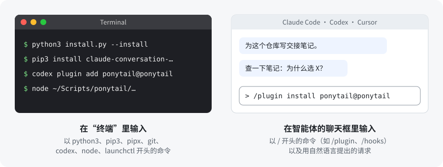
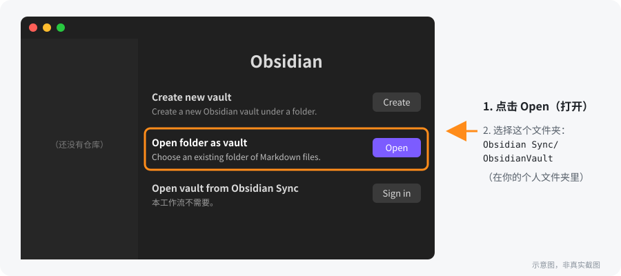
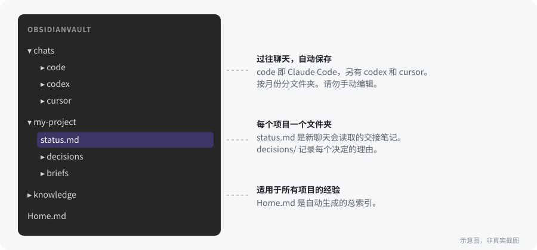

<h1 align="center">智能体工作流</h1>

<p align="center">
  <a href="#quickstart"></a>
  <a href="#setup"></a>
  <a href="#results"></a>
  <a href="README.md"></a>
</p>

<p align="center">
  
  
  
  
  
  <a href="LICENSE"></a>
  
</p>

<h3 align="center">聊天一结束，你的 AI 智能体就什么都忘了。<br>这套工作流给它一本笔记本，再加一套行为准则。</h3>

<p align="center">
  <a href="README.md">English</a> · <strong>简体中文</strong>
</p>

一套现成的 **Claude Code、Codex 和 Cursor** 配置，支持 **Mac 和 Windows**：让智能体每次加载的指令保持精简，引导它做小改动、如实汇报，并把每次聊天保存到 Obsidian，下一次聊天就能接着上次继续。

<a id="contents"></a>
## 🧭 目录

| **从这里开始** | **安装** | **使用** | **参考** |
|---|---|---|---|
| [解决的问题](#problems) | [开始之前](#before) | [日常怎么用](#daily) | [仓库里有什么](#repo) |
| [测试结果](#results) | [第 1 步：安装](#step-1) | [可选扩展](#extras) | [延伸阅读](#reading) |
| [快速开始](#quickstart) | [第 2 步：Obsidian](#step-2) | [ICM](#icm) | [检查（无需调用 AI）](#checks) |
|  | [第 3 步：你的应用](#step-3) | [问题排查](#troubleshooting) | [致谢](#credits) |
|  | [第 4 步：首次同步](#step-4) |  | [许可证](#license) |

---

<a id="problems"></a>
## 🤔 解决的问题

| 没有这套工作流 | 有了这套工作流 |
|---|---|
| ❌ 每个新聊天都从零开始，你得重新解释项目。 | ✅ 智能体读一条 5 到 15 行的交接笔记，接着干。 |
| ❌ 聊天越长越慢越贵，因为整段历史都会被重新发送。 | ✅ 精简的规则和简短的回复让每条消息都很轻。 |
| ❌ 什么都没运行，智能体却说测试通过了。 | ✅ 智能体必须汇报验证过什么，并标出没验证的部分。 |
| ❌ 智能体加了你没要的层级和库。 | ✅ 核心规则要求完成任务所需的最小改动。 |
| ❌ 当初为什么这样决定，埋在某个旧聊天里。 | ✅ 每次聊天都在 Obsidian 里，直接问*“我们为什么这样做 X？”* |
| ❌ 为了找一个函数，智能体把整个文件夹都读一遍。 | ✅ 可选的代码地图（Graphify）让它直接查找。 |
| ❌ 每个应用都要单独配置、单独写规则。 | ✅ Claude Code、Codex 和 Cursor 遵守同一套规则。 |
| ❌ 手动保存聊天很容易忘。 | ✅ 每条消息后在后台自动保存聊天，不消耗任何 AI token。 |

<a id="results"></a>
## 📊 测试结果

最初的 4 步缓存测试统计的是**字符数**，不是 token：回复约短了 49%。这不能证明总 token 用量降低。

后续测试读取 Claude Code 的真实用量计数：364 行 Python 订单程序、连续 5 条编程提示、每种配置各 3 次 Haiku 会话。旧版完整工作流的**总 token 用量高了 73.8%**（每次会话 1,604,721 比 923,168），两组最终均通过 **9/9 项检查**。增加的主要是缓存输入。按标价估算的成本增加 24.4%，不等于订阅实际账单。

**新配置复测：** 总 token 平均减少 4.5%，两组最终都通过 9/9 项检查；估算的 API 成本反而增加 2.5%。每组仅测试了 3 次、任务规模较小、结果波动明显，不能推广为通用节省比例。

新默认配置精简常驻规则、按需读取详细说明、将 Ponytail 改为主动开启，并在能直接读清的小任务中跳过 Graphify 初始化。技能与聊天同步仍可使用。方法与新结果见[基准测试说明](docs/token-benchmark.md)。是否节省取决于任务，不承诺通用节省比例。

<sub>[↑ 回到顶部](#contents)</sub>

---

<a id="quickstart"></a>
## 🚀 快速开始

三条命令装好规则和辅助脚本。**输入位置：终端**（Windows 上用 PowerShell）

Mac：

```bash
git clone https://github.com/zandy700/agent-workflow.git
cd agent-workflow
python3 install.py --install
```

Windows：

```powershell
git clone https://github.com/zandy700/agent-workflow.git
cd agent-workflow
python install.py --install
```

核心部分就装好了。剩下的（Obsidian、你的应用、Ponytail）请从[完整安装](#setup)的第 2 步继续。

---

<a id="setup"></a>
## 🛠️ 完整安装

<a id="before"></a>
### 开始之前

**你需要：**

- [ ] 一台 **Mac** 或 **Windows** 电脑
- [ ] 至少安装并登录 **Claude Code**、**Codex** 或 **Cursor** 之一
- [ ] **Python 3.9 或更新版本**和 **git**
  - Mac：在终端输入 `python3 --version` 和 `git --version` 检查
  - Windows：从 [python.org](https://www.python.org/downloads/) 安装 Python，安装时勾选 **“Add python.exe to PATH”**；再安装 [Git for Windows](https://git-scm.com/download/win)。在 PowerShell 里输入 `python --version` 和 `git --version` 检查。
- [ ] **Node**（仅在安装可选 Ponytail 时需要）：用 `node --version` 检查

> **Windows 支持是新加的。** 已在 Mac 上模拟 Windows 检查过，但还没有在真实的 Windows 电脑上测试。如果遇到问题，欢迎[提交 issue](https://github.com/zandy700/agent-workflow/issues)。

**每条命令在哪里输入。** 每条命令都标明了位置。Mac 上的“终端”（Terminal）在“应用程序 → 实用工具”里。Windows 上，本指南说“终端”的地方请使用 **PowerShell**（在开始菜单里搜索）。Mac 和 Windows 命令不同时，两种都会列出。



**要做哪些步骤。** 第 1、2、4 步所有人都要做；第 3 步只做你在用的应用。

<a id="step-1"></a>
### 第 1 步：安装工作流

如果还没运行过，先运行[快速开始](#quickstart)里的三条命令。安装程序会把规则和辅助脚本复制到你的个人文件夹，并接入每个应用。被替换的文件会备份到 `~/Scripts/agent-workflow-backups/`。重复运行是安全的；没有变化时会提示 "Already installed"（已安装）。

想先看看会改什么，把最后一条命令去掉 `--install` 再运行（Mac：`python3 install.py`，Windows：`python install.py`）。这个预览不会改动任何东西。

<a id="step-2"></a>
### 第 2 步：设置 Obsidian

Obsidian 是一款免费笔记软件，把笔记以纯文本文件存在你电脑上的一个文件夹里，不需要注册账号。本工作流把它当作智能体的“记忆”。

**2.1 安装 Obsidian：** 从 [obsidian.md](https://obsidian.md) 下载并打开。

**2.2 打开仓库（vault）。** 在 Obsidian 里，“仓库”就是它显示的那个文件夹，安装程序已经建好了。在启动界面点击 **Open folder as vault**（中文界面为“打开本地仓库”）旁边的 **Open**（打开），然后选择个人文件夹中 `Obsidian Sync` 文件夹里的 `ObsidianVault`。



> 找不到这个文件夹？Mac 上在文件选择窗口按 `Cmd+Shift+G`，粘贴 `~/Obsidian Sync/ObsidianVault`；Windows 上把 `%USERPROFILE%\Obsidian Sync\ObsidianVault` 粘贴到选择窗口的地址栏。“Obsidian Sync”只是文件夹的名字，不需要购买 Obsidian 的付费同步服务。

**2.3 在关系图谱中隐藏自动生成的笔记（可选）。** 只有开启 [Graphify](#extras) 后才需要。打开 **Graph view**（关系图谱），点击右上角的齿轮图标，在 **Filters**（筛选）搜索框输入 `-path:graphify`。

> 你的仓库里会保存智能体聊天的文字内容，请只放在个人电脑上。

<a id="step-3"></a>
### 第 3 步：配置你的应用

**Ponytail 为可选项。** 新配置默认关闭自动启用；需要时在聊天框输入 `/ponytail lite` 或 `/ponytail full`。安装器保留已有的明确偏好；如已有自动开启配置，将 Ponytail 配置文件中的 `defaultMode` 改为 `off`。

**已安装 mgrep 或 Superpowers？** 它们的启动钩子可能额外注入指令。参照[可选插件配置](payload/scripts/agent-workflow-reference.md#optional-plugin-startup-guidance)，关闭自动加载并保留安装，需要时再启用。安装器会保留已有插件偏好；这项额外调整尚未进行 token 基准测试。

只做你在用的应用。每个应用都分三部分：**规则**、**Ponytail**、**保存聊天**。

**跳转到：** [3a. Claude Code](#app-claude) · [3b. Codex](#app-codex) · [3c. Cursor](#app-cursor)

| | Claude Code | Codex | Cursor |
|---|---|---|---|
| 规则 | 无需操作 | 无需操作 | 粘贴一次 |
| Ponytail（可选） | 在聊天框发 2 条消息 | 在终端运行 2 条命令 | 在终端运行 2 条命令 |
| 保存聊天 | 安装一个工具 | 批准一个钩子（hook） | 无需操作 |

<a id="app-claude"></a>
<details open>
<summary><strong>3a. Claude Code</strong></summary>

**规则：** 无需操作，第 1 步已经装好了。

**Ponytail（可选，按需开启）：** 在 Claude Code 的聊天框里分两条消息发送：

```text
/plugin marketplace add DietrichGebert/ponytail
```

```text
/plugin install ponytail@ponytail
```

**保存聊天：** Claude Code 的聊天由一个叫 `claude-extract` 的小工具导出。输入位置：终端

Mac：

```bash
pip3 install claude-conversation-extractor
```

Windows：

```powershell
python -m pip install claude-conversation-extractor
```

Mac 上如果提示 "externally managed environment"（外部管理的环境）而失败，改用：

```bash
brew install pipx
pipx install claude-conversation-extractor
```

</details>

<a id="app-codex"></a>
<details open>
<summary><strong>3b. Codex</strong></summary>

**规则：** 无需操作，第 1 步已经装好了。

**Ponytail（可选，按需开启）：** 输入位置：终端

```bash
codex plugin marketplace add DietrichGebert/ponytail
codex plugin add ponytail@ponytail
```

**保存聊天：** Codex 在你批准之前不会运行新的钩子。这一步开启聊天保存；只有安装了可选 Ponytail 才需要批准其钩子。在 Codex 的聊天框输入：

```text
/hooks
```

批准（trust）运行 `agent_stop_hook.py` 的钩子（它负责保存聊天）；如果安装了 Ponytail，也批准它的钩子，然后开一个新对话。

</details>

<a id="app-cursor"></a>
<details open>
<summary><strong>3c. Cursor</strong></summary>

**规则：** Cursor 把规则保存在应用内部，需要手动添加一次：

1. 打开下载文件夹里的 `payload/cursor/USER_RULES.md`，复制全部内容。
2. 在 Cursor 中进入 **Customize → Rules → User Rules**，粘贴并保存。（[Cursor 规则说明](https://cursor.com/docs/rules)）

**Ponytail（可选，按需开启）：** 输入位置：终端

Mac 和 Windows 通用：

```bash
git clone https://github.com/DietrichGebert/ponytail "$HOME/Scripts/ponytail"
node "$HOME/Scripts/ponytail/scripts/cursor-hooks.js" install
```

不要移动 `~/Scripts/ponytail` 文件夹，Cursor 从这里运行 Ponytail。

**保存聊天：** 无需操作。Cursor 会自动使用第 1 步装好的聊天保存钩子。

</details>

<a id="step-4"></a>
### 第 4 步：首次同步并检查

**4.1 把已有的聊天复制到 Obsidian。** 从现在起聊天会自动保存；这条只需运行一次的命令会把已有的聊天也复制过去。输入位置：终端

Mac：

```bash
python3 "$HOME/Obsidian Sync/sync_claude_obsidian.py" --all
```

Windows：

```powershell
python "$HOME/Obsidian Sync/sync_claude_obsidian.py" --all
```

**4.2 在 Obsidian 里查看。** 你应该能看到 `chats` 文件夹和 `Home.md` 笔记。用了一段时间后大致是这样：



**4.3 检查每个应用都加载成功。** 在每个应用里开一个**新**聊天（规则在聊天开始时加载），发送：

```text
你从全局指令里加载了哪些工作流规则？Ponytail 是否仅在主动开启后才启用？
```

它应该会提到：检查自己的工作、保持输出简短、在 Obsidian 写交接笔记。Ponytail 应保持关闭，除非你主动开启。再发一条消息，等几秒钟，今天的聊天应该会出现在 `chats/` 下面。

**4.4 每晚自动全量同步（可选）。** 每天晚上 10 点重新同步所有内容并刷新索引笔记。输入位置：终端

Mac：

```bash
launchctl bootstrap "gui/$(id -u)" "$HOME/Library/LaunchAgents/local.agent-workflow.obsidian-sync.plist"
```

Windows：安装程序在第 1 步结束时打印了一行 `Register-ScheduledTask ...`，把它粘贴到 PowerShell 运行即可。想再看一次，运行 `python install.py`。

<sub>[↑ 回到顶部](#contents)</sub>

---

<a id="daily"></a>
## 💬 日常怎么用

大多数时候你只需要跟智能体对话（用中文说就行）：

| 什么时候 | 对智能体说 |
|---|---|
| 关闭一段很长的聊天之前 | *“为这个项目写交接笔记。”* |
| 在同一个项目开新聊天时 | *“读一下交接笔记，然后继续。”* |
| 需要找以前的决定 | *“查一下笔记：我们为什么这样做 X？”* |
| 你在几个可行方案中做了选择 | *“为这个决定写一份 ADR（架构决策记录）。”* |
| 学到了值得保留的经验 | *“保存这个。”* |
| 想为某个流程搭一套分步结构，或给杂乱的文件夹画张地图 | *“/icm-architect map this repo.”*（需要先装 [ICM](#extras)） |

交接笔记是 5 到 15 行的摘要：做完了什么、哪里有问题、下一步做什么。智能体只搜索你问到的内容，从不把整个仓库都加载进来。

**Ponytail 设置**（在聊天框输入）：

| 命令 | 作用 |
|---|---|
| `/ponytail lite` | 宽松一些 |
| `/ponytail full` | 在当前聊天开启完整指导 |
| `/ponytail ultra` | 最严格 |
| `stop ponytail` | 关闭 |

如需彻底卸载，请看 [Ponytail 的卸载步骤](https://github.com/DietrichGebert/ponytail#uninstall)。

<a id="extras"></a>
## 🧩 可选扩展

需要时再装，不装也完全能用。

<details>
<summary><strong>Graphify：更快找到代码</strong></summary>

为代码项目建一张“地图”，让智能体直接查找，而不用整个文件夹逐个读。在你的电脑本地运行，不消耗 AI 用量。输入位置：终端

Mac：

```bash
pip3 install graphifyy          # 或：pipx install graphifyy
```

Windows：

```powershell
python -m pip install graphifyy
```

然后每个项目运行一次（不要在个人文件夹根目录运行）：

Mac：

```bash
~/Scripts/graphify-bootstrap /path/to/your/project
```

Windows：

```powershell
& "$HOME/Scripts/graphify-bootstrap.cmd" C:\path\to\your\project
```

Mac 上如果想以后直接输入 `graphify-bootstrap`，运行 `echo 'export PATH="$HOME/Scripts:$PATH"' >> ~/.zshrc`，再打开一个新的终端窗口。

</details>

<details>
<summary><strong>MarkItDown：读取文档</strong></summary>

让智能体把 PDF、Word 和 PowerPoint 文件转成文本，只读需要的部分。输入位置：终端

Mac：

```bash
pip3 install 'markitdown[all]'  # 或：pipx install 'markitdown[all]'
```

Windows：

```powershell
python -m pip install 'markitdown[all]'
```

</details>

<a id="icm"></a>
<details>
<summary><strong>ICM：让项目结构对智能体友好</strong></summary>

ICM（Interpretable Context Methodology，可解释上下文方法）把一个反复执行的流程，或者一个杂乱的文件夹/代码仓库，变成按编号排列的纯 Markdown 文件夹，让智能体一步一步地走。它分两部分：

- **icm-architect** 设计新的结构，或者为现有文件夹绘制“地图”，方便智能体找到东西。
- **icm** 提供方法说明和现成模板。第 1 步已经装好了 `/icm` 技能，它会读取你在这里下载的模板。

ICM 本身由 RinDig 开发。`/icm` 技能，以及 ICM 接入本工作流的方式（智能体何时用哪一个、两者如何配合、新工作区放在你的项目里而不是下载的副本里），由 [zandy700](https://github.com/zandy700) 编写和精细调整。

下载这两个仓库。输入位置：终端（Mac 和 Windows 通用）

```bash
git clone https://github.com/RinDig/Interpretable-Context-Methodology "$HOME/Scripts/icm"
git clone https://github.com/RinDig/icm-architect "$HOME/Scripts/icm-architect"
```

然后让 icm-architect 在三个应用里都可用。

Mac：

```bash
for d in .claude .agents .cursor; do mkdir -p "$HOME/$d/skills" && ln -sfn "$HOME/Scripts/icm-architect" "$HOME/$d/skills/icm-architect"; done
```

Windows（“junction”是一种文件夹快捷方式，不需要管理员权限）：

```powershell
foreach ($d in ".claude", ".agents", ".cursor") { New-Item -ItemType Directory -Force "$HOME\$d\skills" | Out-Null; New-Item -ItemType Junction -Force -Path "$HOME\$d\skills\icm-architect" -Target "$HOME\Scripts\icm-architect" | Out-Null }
```

开一个新聊天，试试 *“/icm-architect map this repo”* 或 *“把这个文件夹做成 ICM”*。以后要更新，运行 `git -C "$HOME/Scripts/icm-architect" pull`（`icm` 同理）。

</details>

<sub>[↑ 回到顶部](#contents)</sub>

---

<a id="troubleshooting"></a>
## 🩺 问题排查

| 问题 | 怎么办 |
|---|---|
| Obsidian 里没有聊天记录 | 查看日志最后几行。Mac：`tail -20 "$HOME/Obsidian Sync/claude_obsidian_sync.log"` · Windows：`Get-Content "$HOME/Obsidian Sync/claude_obsidian_sync.log" -Tail 20` |
| 缺少 Claude Code 的聊天 | 在终端运行 `claude-extract --help`。如果报错，重做 [Claude Code 的保存聊天](#app-claude) |
| 缺少 Codex 的聊天 | 你在 `/hooks` 里批准钩子了吗？见 [Codex](#app-codex) |
| 智能体不遵守规则 | 开一个新聊天；规则只在聊天开始时加载 |
| 每晚同步没有运行 | Mac：`launchctl print "gui/$(id -u)/local.agent-workflow.obsidian-sync"` · Windows：`Get-ScheduledTask agent-workflow-obsidian-sync` |
| Windows：输入 `python` 却打开了 Microsoft Store | 从 [python.org](https://www.python.org/downloads/) 重新安装 Python 并勾选“Add python.exe to PATH”，然后重新运行安装程序 |
| 在 Windows 上移动或升级了 Python | 再运行一次 `python install.py --install`，让钩子指向新的 Python |

<sub>[↑ 回到顶部](#contents)</sub>

---

<a id="repo"></a>
## 📁 仓库里有什么

```
agent-workflow/
├── README.md            本说明（English）
├── README.zh-CN.md      本说明（简体中文）
├── LICENSE              MIT 许可证
├── install.py           安装程序（第 1 步）
├── payload/             安装程序要复制的所有文件
│   ├── claude/          Claude Code 的规则
│   ├── codex/           Codex 的规则
│   ├── cursor/          要粘贴到 Cursor 的规则
│   ├── obsidian/        保存聊天和整理仓库的脚本
│   ├── skills/          /icm 技能
│   └── scripts/         按需读取的参考文件、文档扫描脚本
└── docs/                详细指南和本页用到的图片
```

<a id="reading"></a>
## 📚 延伸阅读

以下文档目前只有英文版：

- [How it works](docs/how-it-works.md)：用图解说明什么时候加载什么、在哪里节省 token
- [Using the Obsidian notes](docs/obsidian-notes-guide.md)：交接笔记、决策记录、经验沉淀、参考摘要

<a id="checks"></a>
## 🧪 检查（无需调用 AI）

下面的命令检查脚本有没有错误，并把安装程序装到一个临时文件夹里试运行，全程不调用任何 AI 模型：

```bash
python3 -m py_compile install.py payload/obsidian/*.py payload/scripts/*.py
python3 install.py --home "$(mktemp -d)" --install
```

想在 Mac 上检查 Windows 的输出：先导入标准库，再设置 `sys.platform = "win32"`，然后用 `runpy` 对一个临时的 `--home` 运行 `install.py`。

<a id="credits"></a>
## 🙏 致谢

本工作流把其他人开发的工具串在一起。它们都从各自的官方来源安装，没有打包在这里：

- [Ponytail](https://github.com/DietrichGebert/ponytail)，作者 DietrichGebert（MIT 许可证）
- [Obsidian](https://obsidian.md)
- [Interpretable Context Methodology](https://github.com/RinDig/Interpretable-Context-Methodology) 和 [icm-architect](https://github.com/RinDig/icm-architect)，作者 RinDig（MIT 许可证）
- [Graphify](https://pypi.org/project/graphifyy/)、[MarkItDown](https://github.com/microsoft/markitdown)、[claude-conversation-extractor](https://pypi.org/project/claude-conversation-extractor/)

<a id="license"></a>
## 📄 许可证

[MIT](LICENSE)。可以免费使用、修改和分享（包括商业用途），只需保留版权声明。按“原样”提供，不附带任何担保。

<p align="center"><sub><a href="#contents">↑ 回到顶部</a></sub></p>
