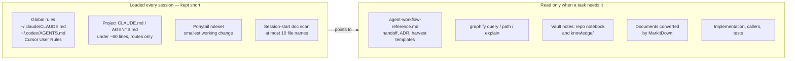
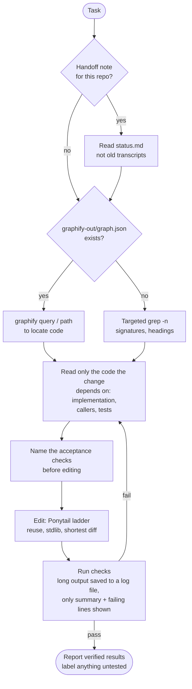
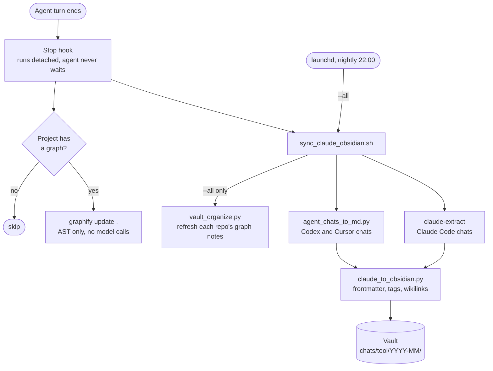
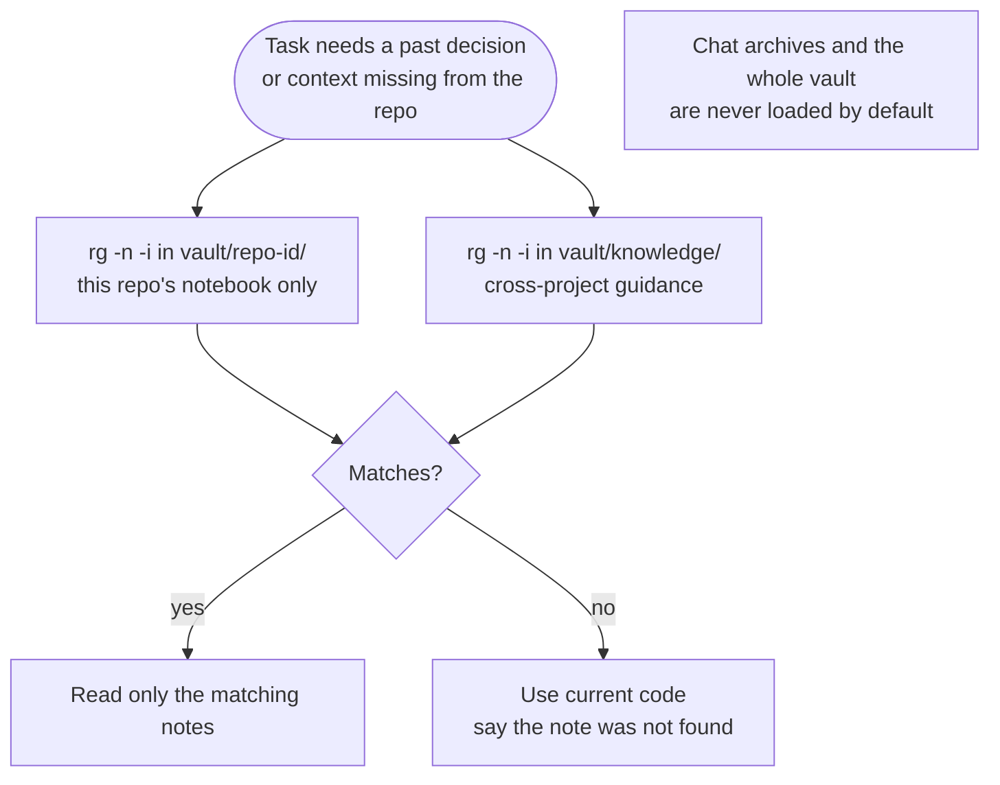
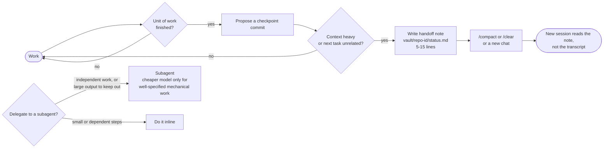

# How the workflow works

The idea behind every piece: **keep what loads into every turn small, and fetch everything else only when a task needs it.** Each turn re-sends the whole conversation, so a line that is always loaded costs on every turn, and a file that is read only on demand costs once.

These diagrams show where tokens are avoided. They are not measurements; the package makes no claim of a measured saving on your machine.

## 1. Always loaded vs on demand

The rule files hold routing, not procedures. Templates and step-by-step workflows live in `agent-workflow-reference.md`, which the agent opens only when it is doing one of them.

## 2. One task, start to finish

Locating with a graph or a targeted search replaces reading whole directories. Long test and build output goes to a file, and only the summary and the failing lines enter the conversation.

## 3. After every turn: chats and graph stay current

None of this runs inside the agent's context. The hooks spend no model tokens; they keep the graph and the vault ready so later sessions can look things up instead of re-reading code or transcripts.

## 4. Recalling past context

One repo maps to one graph and one vault namespace, so a search never pulls in another project's notes.

## 5. Keeping context small over a long session

A handoff note of 5 to 15 lines replaces carrying a whole transcript forward. Subagents start cold, so they are used only when they keep large output out of the main context or run independent work in parallel.
