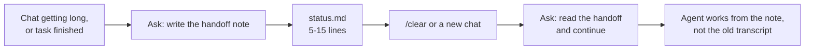

# Using the Obsidian notes

The vault is the agent's long-term memory. A chat forgets everything when it ends or gets cleared; a note in the vault survives, and the next session can read just that note instead of a whole old conversation. This guide shows how to use it day to day.

You rarely write these notes by hand. You ask the agent to write them, and you tell the next session where to look. Everything below includes the prompt to use.

## Where things live

The vault is at `~/Obsidian Sync/ObsidianVault`. Open that folder as a vault in Obsidian.

```
ObsidianVault/
├── Home.md                      generated: list of projects and chat folders
├── <repo-id>/                   one notebook per repository (repo-id = repo folder name)
│   ├── <repo-id> Home.md        generated index of this notebook
│   ├── status.md                handoff note: where the work stands right now
│   ├── handoffs/<branch>.md     handoff notes when several branches run at once
│   ├── decisions/ADR-0001-….md  decisions and why they were made
│   └── briefs/…                 condensed reference material (specs, long pasted docs)
├── knowledge/                   lessons that apply across projects
├── chats/<tool>/<YYYY-MM>/      every chat, synced automatically after each turn
└── graphify/<repo-id>/          generated code-graph notes; never edit by hand
```

| You write (through the agent) | Generated, read-only |
|---|---|
| `status.md`, `handoffs/`, `decisions/`, `briefs/`, `knowledge/`, your own notes | `Home.md`, `<repo-id> Home.md`, `chats/`, `graphify/` |

Generated files get rewritten. Anything you type into them is lost.

## 1. Hand context to a new session

This is the most useful habit. Long chats get slow and expensive, because every turn re-sends the whole conversation. When a chat is heavy, or the next task is unrelated, move to a fresh one, and carry over only a short note.



**Step 1. In the old chat:**

> Write the handoff note for this repo.

The agent overwrites `<vault>/<repo-id>/status.md` with something like:

```markdown
# promptbox status (2026-10-09)
Branch/worktree: main @ 9ae2267, clean
Done: Fixed timeout handling in src/App.ts (kept 30s); added retry test.
Verified: npm test -> 42 passed, 0 failed
Unresolved: Queue approach not chosen yet; user wants to decide first.
Next: Ask user whether to add a request queue for retries.
```

Check it before moving on. It should tell a stranger what's done, what was verified, what's broken (with the exact error text), and the one next step.

**Step 2. Start fresh:** type `/clear`, or open a new chat in the same project folder.

**Step 3. In the new chat:**

> Read the handoff note for this repo and continue with the next step.

Or give the path directly:

> Read ~/Obsidian Sync/ObsidianVault/promptbox/status.md and continue.

### Rules that keep handoffs useful

- **Overwrite, don't append.** `status.md` is the current state, not a diary. If it has grown into a log, ask the agent to move the history into a separate project note and rewrite status.
- **5 to 15 lines.** Longer means it's carrying things the next session doesn't need.
- **Exact error text.** "Tests fail" is useless; the actual failing line is what saves the next session from re-running everything.
- **Parallel work gets its own file.** Two branches or worktrees at once: ask for `handoffs/<branch>.md` per branch so they don't overwrite each other.

### `/compact` vs `/clear`

| Use | When | What happens |
|---|---|---|
| `/compact keep the failing test output and the plan` | Same task, context is heavy | History is summarized; you stay in the same chat |
| `/clear` + handoff note | Task done, or next task unrelated | History is gone; the note is the only carry-over |

Write the handoff note before either one. A note doesn't shrink the chat; only `/compact`, `/clear`, or a new chat does.

## 2. Point a session at an old chat

Every chat is saved under `chats/<tool>/<YYYY-MM>/` automatically. Agents never load these on their own, because they're long. When one has something you need, pass the path and say what to look for:

> ~/Obsidian Sync/ObsidianVault/chats/code/2026-10/claude-conversation-2026-10-09-8e65b8a7.md — check what we decided about the stop hook.

Better: once you find what mattered in an old chat, have it written into a handoff, a decision, or a knowledge note, so nobody needs the transcript again.

To find a chat, use Obsidian's search (`Cmd+Shift+F` on Mac, `Ctrl+Shift+F` on Windows), or ask the agent: *"Search the chats folder for 'graphify-bootstrap' and list matching files."*

## 3. Ask about past decisions

When a task needs history that isn't in the code, the agent searches that repo's notebook (and `knowledge/`) with `rg`, then reads only the matching notes. It never loads the whole vault. You can trigger it directly:

> Check the notes: why did we choose launchd over cron?

If nothing matches, it says so and works from the current code.

## 4. Record decisions (ADRs)

When you pick between real alternatives (a library, a data model, an architecture, or an unusual pattern you chose on purpose), the agent writes an ADR to `<repo-id>/decisions/ADR-NNNN-<slug>.md`:

```markdown
# ADR-0003: Install Ponytail from upstream instead of bundling
Date: 2026-10-09 | Status: accepted
Decision: README gives each app's official install command; no vendored code.
Alternatives considered: copy the repo into payload/; automate in install.py.
Rationale: upstream keeps updating; Cursor hooks need a stable clone path.
#adr #shareable-agent-workflow
```

Before changing that area later, the agent checks `decisions/` first, so a future session doesn't undo a choice without knowing why it was made. Decisions are never deleted; a new ADR marks the old one "superseded". Prompt: *"Write an ADR for this decision."*

## 5. Save lessons for every project (harvest)

When you learn something reusable, say **"save this"** or **"harvest"**. The agent writes one short note (10 to 40 lines) to `knowledge/`, or updates a matching one instead of creating a duplicate. Every project can find it later.

Good harvests: a fix for a tool quirk, a checklist that worked, a pattern you'll reuse. Not secrets, and not personal data.

## 6. Keep long reference material as a brief

Pasting a long spec into every chat costs tokens every time. For reference material of roughly 800 words or more that later sessions will need, ask:

> Save this as a brief for this repo.

It goes to `<repo-id>/briefs/<date>-<slug>.md`, with every requirement, number, name, path, and error text kept exact, and repetition removed. Later: *"Read the brief on the payment API and implement step 2."*

## 7. Organize your own notes

Inside a project notebook you can add your own notes freely. If it helps, sort them PARA-style (projects, areas, resources, archives); see `obsidian-organization.md` in the vault's `knowledge/` folder. Link related notes with `[[Note Name]]` so they show up together in Graph View. Keep one notebook per repository, and leave the generated folders alone.

Tip: in Graph View, filter with `-path:graphify` to hide the thousands of generated code-graph notes.

## Prompt cheat sheet

| Goal | Say |
|---|---|
| Save where you are | "Write the handoff note for this repo." |
| Resume in a new chat | "Read the handoff note for this repo and continue." |
| Branch-specific handoff | "Write a handoff note for branch `feature-x`." |
| Use an old chat | "<path to chat note> — find what we decided about X." |
| Ask the past | "Check the notes: why did we do X?" |
| Record a choice | "Write an ADR for this decision." |
| Keep a lesson | "Save this." / "Harvest." |
| Keep a long spec | "Save this as a brief for this repo." |

## Common mistakes

- **Pasting whole transcripts into a new chat.** That brings back all the tokens you just cleared. Pass a handoff note or a specific path instead.
- **Letting `status.md` grow.** It's a snapshot. History goes in other notes.
- **Editing `graphify/`, `chats/`, or Home notes.** They are regenerated, and your edits disappear.
- **Mixing repos.** One repo, one notebook. Cross-project lessons go in `knowledge/`.
- **Handing off without verifying.** "Verified: not run" is honest and fine; a claimed pass that never ran misleads the next session.
